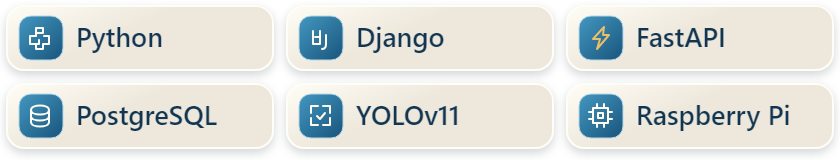
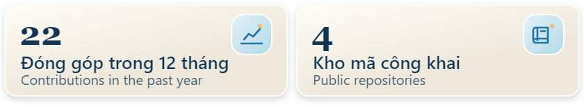

  

  <strong>Chào bạn, mình là Uyên! · Hi, I’m Uyên!</strong>

  <a href="#ve-minh">Về mình · About</a> &nbsp;·&nbsp;
  <a href="#du-an">Dự án · Projects</a> &nbsp;·&nbsp;
  <a href="#cong-nghe">Công nghệ · Toolkit</a> &nbsp;·&nbsp;
  <a href="#hoat-dong">Hoạt động · Activity</a> &nbsp;·&nbsp;
  <a href="#goc-nho">Góc nhỏ · My corner</a>

## Về mình · About me

Mình thích làm phần mềm cho những việc hằng ngày trong y tế và cộng đồng. Mình thường bị cuốn vào những bài toán rất cụ thể, như giúp dược sĩ đếm thuốc trên khay hoặc giúp người gây quỹ theo dõi từng khoản đóng góp.

I like building software for everyday work in healthcare and in the community. I’m drawn to practical problems, like helping pharmacists count pills on a tray or helping fundraisers keep track of each donation.

## Dự án yêu thích · Favorite projects

<table width="100%">
  <tr>
    <td valign="top" width="50%">
      <a href="https://github.com/pbl4-hotrodemthuoc/PILL-COUNTER-PROJECT">
         
        <strong>Đếm thuốc · Pill Counter</strong>
      </a> 
      YOLOv11 · Raspberry Pi  
      Dự án nhóm dùng thị giác máy tính để hỗ trợ dược sĩ đếm viên thuốc trên khay. 
      A team project that uses computer vision to help pharmacists count pills on a tray.
    </td>
    <td valign="top" width="50%">
      <a href="https://github.com/BichUyen2609/project_python/tree/journeys/apps/fundraising">
         
        <strong>Trái tim cho em · A Heart for You</strong>
      </a> 
      Python · Django  
      Mô-đun Django giúp tạo chiến dịch gây quỹ cho các em và ghi nhận từng khoản đóng góp. 
      A Django module for creating fundraising campaigns for children and recording each donation.
    </td>
  </tr>
</table>

## Công nghệ mình dùng · My toolkit

  

### Đang mày mò · What I’m learning

Mình luyện viết API với FastAPI qua [TaskHub](https://github.com/BichUyen2609/fastapi-backend-training), một backend quản lý công việc có phân trang và truy vấn bất đồng bộ trên PostgreSQL.

I’m practicing API development with FastAPI in [TaskHub](https://github.com/BichUyen2609/fastapi-backend-training), a task management backend with pagination and asynchronous PostgreSQL queries.

## Hoạt động GitHub · GitHub activity

   
  Số liệu ngày 27/11/2026 · Snapshot on 27 Nov 2026 
  <a href="https://github.com/users/BichUyen2609/contributions">Lịch đóng góp · Contribution calendar</a> &nbsp;·&nbsp;
  <a href="https://github.com/BichUyen2609?tab=repositories">Kho mã · Repositories</a>

## Góc nhỏ của Uyên · My little corner

  <picture>
    <source media="(prefers-reduced-motion: reduce)" srcset="./assets/little-friends.png" />
    
  </picture>

- **Âm thanh · Sound** 
  Mình thích những nốt nhạc và âm thanh nhỏ mang lại không khí cho một trang web. 
  I like the notes and little sounds that give a website its own atmosphere.
- **Viết lách · Writing** 
  Mình thích viết vài dòng để giữ lại một ý tưởng hoặc một chuyện nhỏ trong ngày. 
  I like to write a few lines to remember an idea or a small moment from the day.
- **Những thứ nhỏ xinh · Cute little things** 
  Mình mê mấy nhân vật bé xíu, nhất là khi tụi nó cử động được như ba bạn ở trên. 
  I love tiny characters, especially when they come to life like the three friends above.
