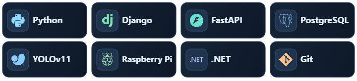
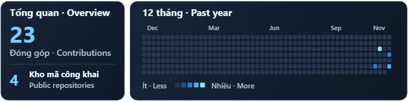

  

<h1 align="center">
  
</h1>

  <strong>Chào bạn, mình là Uyên! · Hi, I’m Uyên!</strong>

## 🌙 Về mình · About me

<table width="100%">
  <tr>
    <td width="68%" valign="middle">
      

        <strong>💙 Y tế và cộng đồng · Healthcare and community</strong> 
        Mình thích viết phần mềm giúp những việc hằng ngày dễ hơn, từ đếm thuốc trên khay đến theo dõi từng khoản đóng góp. 
        I like building software that makes everyday tasks easier, from counting pills on a tray to keeping track of donations.
      

      

        <strong>🎧 Âm thanh và chuyển động · Sound and motion</strong> 
        Mình mê những âm thanh nhỏ và mấy nhân vật cử động trên web, như ba bạn bên cạnh. 
        I love little sounds and playful web animations, like the three friends beside me.
      

      

        <strong>✍️ Viết lách · Writing</strong> 
        Mình thích ghi vài dòng để giữ lại một ý tưởng hoặc một chuyện nhỏ trong ngày. 
        I like jotting down an idea or a little moment from the day.
      

    </td>
    <td width="32%" valign="middle" align="center">
      <picture>
        <source media="(prefers-reduced-motion: reduce)" srcset="./assets/night-friends.png" />
        
      </picture>
    </td>
  </tr>
</table>

## 🛠️ Công nghệ · Tech stack

  

## 📊 Hoạt động GitHub · GitHub activity

   
  Số liệu ngày 27/11/2026 · Snapshot on 27 Nov 2026 · <a href="https://github.com/BichUyen2609?tab=repositories">Kho mã · Repositories</a>

## 💙 Dự án yêu thích · Favorite projects

<table width="100%">
  <tr>
    <td width="50%" valign="top">
      <strong><a href="https://github.com/pbl4-hotrodemthuoc/PILL-COUNTER-PROJECT">Đếm thuốc · Pill Counter</a></strong> 
      YOLOv11 · Raspberry Pi  
      Dự án nhóm dùng thị giác máy tính để hỗ trợ dược sĩ đếm viên thuốc trên khay. 
      A team project that uses computer vision to help pharmacists count pills on a tray.
    </td>
    <td width="50%" valign="top">
      <strong><a href="https://github.com/BichUyen2609/project_python/tree/journeys/apps/fundraising">Trái tim cho em · A Heart for You</a></strong> 
      Python · Django  
      Mô-đun Django giúp tạo chiến dịch gây quỹ cho các em và ghi nhận từng khoản đóng góp. 
      A Django module for creating fundraising campaigns for children and recording each donation.
    </td>
  </tr>
</table>

### Đang mày mò · What I’m learning

Mình luyện viết API với FastAPI qua [TaskHub](https://github.com/BichUyen2609/fastapi-backend-training), một backend quản lý công việc có phân trang và truy vấn bất đồng bộ trên PostgreSQL.

I’m practicing API development with FastAPI in [TaskHub](https://github.com/BichUyen2609/fastapi-backend-training), a task management backend with pagination and asynchronous PostgreSQL queries.

<!-- Tech icons from Simple Icons (https://simpleicons.org/). -->
