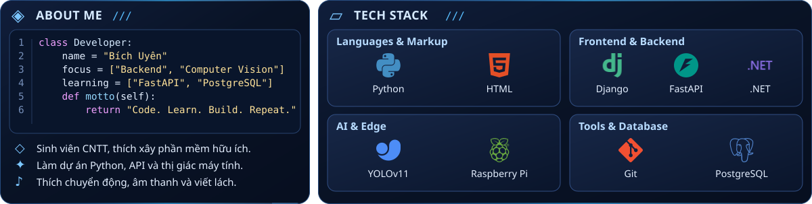
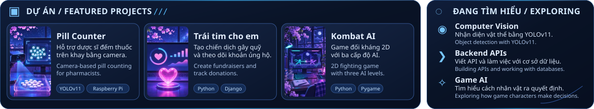

  

  <picture>
    <source media="(max-width: 600px)" srcset="./assets/beyond/intro-mobile.svg" />
    
  </picture>

  <picture>
    <source media="(max-width: 600px)" srcset="./assets/beyond/about-and-tech-mobile.svg" />
    
  </picture>

  <picture>
    <source media="(max-width: 600px)" srcset="./assets/beyond/projects-and-focus-mobile.svg" />
    
  </picture>

  <a href="https://github.com/pbl4-hotrodemthuoc/PILL-COUNTER-PROJECT"><strong>Pill Counter ↗</strong></a>
  &nbsp;·&nbsp;
  <a href="https://github.com/BichUyen2609/project_python/tree/journeys/apps/fundraising"><strong>Trái tim cho em ↗</strong></a>
  &nbsp;·&nbsp;
  <a href="https://github.com/BichUyen2609/fastapi-backend-training"><strong>TaskHub ↗</strong></a>

  <a href="https://github.com/users/BichUyen2609/contributions">
    <picture>
      <source media="(max-width: 600px)" srcset="https://raw.githubusercontent.com/BichUyen2609/BichUyen2609/output/profile-activity-mobile.svg" />
      
    </picture>
  </a>

  <picture>
    <source media="(prefers-color-scheme: dark)" srcset="https://raw.githubusercontent.com/BichUyen2609/BichUyen2609/output/github-contribution-grid-snake-dark.svg" />
    
  </picture>

  <strong>Connect with me</strong>
  &nbsp;
  
  
  

  

<!-- Tech icons from Simple Icons (https://simpleicons.org/). -->
