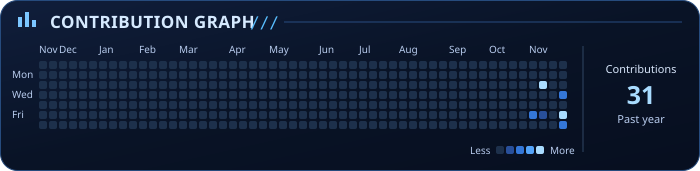
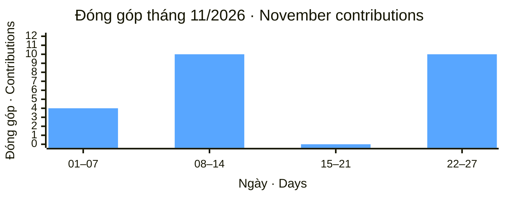

<p align="center">
  
</p>

<h1 align="center">
  
</h1>

<p align="center">
  <strong>Hello, World! · Chào bạn, mình là Uyên!</strong>
</p>

<p align="center">
  <picture>
    <source media="(prefers-reduced-motion: reduce)" srcset="./assets/profile-tagline.svg" />
    
  </picture>
</p>

## 🖥️ Về mình · About me

```python
class Developer:
    name = "Bích Uyên"
    role = "IT Student"
    interests = ("Python backends", "Computer vision", "Creative web")
    currently_learning = ("FastAPI", "Async PostgreSQL")

    def say_hi(self):
        print(f"Cảm ơn bạn đã ghé GitHub của {self.name}! 🌙")


Developer().say_hi()
```

<table width="100%">
  <tr>
    <td width="68%" valign="middle">
      <p>
        <strong>💙 Y tế và cộng đồng · Healthcare and community</strong><br />
        <span lang="vi">Mình thích viết phần mềm giúp những việc hằng ngày dễ hơn, từ đếm thuốc trên khay đến theo dõi từng khoản đóng góp.</span><br />
        <span lang="en">I like building software that makes everyday tasks easier, from counting pills on a tray to keeping track of donations.</span>
      </p>
      <p>
        <strong>🎧 Âm thanh và chuyển động · Sound and motion</strong><br />
        <span lang="vi">Mình mê những âm thanh nhỏ và mấy nhân vật cử động trên web, như ba bạn bên cạnh.</span><br />
        <span lang="en">I love little sounds and playful web animations, like the three friends beside me.</span>
      </p>
      <p>
        <strong>✍️ Viết lách · Writing</strong><br />
        <span lang="vi">Mình thích ghi vài dòng để giữ lại một ý tưởng hoặc một chuyện nhỏ trong ngày.</span><br />
        <span lang="en">I like jotting down an idea or a little moment from the day.</span>
      </p>
    </td>
    <td width="32%" valign="middle" align="center">
      <picture>
        <source media="(prefers-reduced-motion: reduce)" srcset="./assets/night-friends.png" />
        
      </picture>
    </td>
  </tr>
</table>

## ⚡ Công nghệ · Tech stack

<table width="100%">
  <thead>
    <tr>
      <th width="30%">Ngôn ngữ<br /><sub>Languages</sub></th>
      <th width="40%">Framework &amp; thư viện<br /><sub>Frameworks &amp; libraries</sub></th>
      <th width="30%">CSDL &amp; công cụ<br /><sub>Databases &amp; tools</sub></th>
    </tr>
  </thead>
  <tbody>
    <tr>
      <td align="center" valign="top">
        <a href="https://www.python.org/"> Python</a><br />
        <a href="https://developer.mozilla.org/en-US/docs/Web/HTML"> HTML</a>
      </td>
      <td align="center" valign="top">
        <a href="https://www.djangoproject.com/"> Django</a><br />
        <a href="https://fastapi.tiangolo.com/"> FastAPI</a><br />
        <a href="https://docs.ultralytics.com/models/yolo11/"> YOLOv11</a><br />
        <a href="https://dotnet.microsoft.com/"> .NET</a>
      </td>
      <td align="center" valign="top">
        <a href="https://www.postgresql.org/"> PostgreSQL</a><br />
        <a href="https://git-scm.com/"> Git</a><br />
        <a href="https://www.raspberrypi.com/"> Raspberry Pi</a>
      </td>
    </tr>
  </tbody>
</table>

## 💙 Dự án yêu thích · Favorite projects

<table width="100%">
  <tr>
    <td width="50%" valign="top">
      <strong><a href="https://github.com/pbl4-hotrodemthuoc/PILL-COUNTER-PROJECT">Đếm thuốc · Pill Counter</a></strong><br />
      <sub>YOLOv11 · Raspberry Pi</sub><br /><br />
      <span lang="vi">Dự án nhóm dùng thị giác máy tính để hỗ trợ dược sĩ đếm viên thuốc trên khay.</span><br />
      <span lang="en">A team project that uses computer vision to help pharmacists count pills on a tray.</span>
    </td>
    <td width="50%" valign="top">
      <strong><a href="https://github.com/BichUyen2609/project_python/tree/journeys/apps/fundraising">Trái tim cho em · A Heart for You</a></strong><br />
      <sub>Python · Django</sub><br /><br />
      <span lang="vi">Mô-đun Django giúp tạo chiến dịch gây quỹ cho các em và ghi nhận từng khoản đóng góp.</span><br />
      <span lang="en">A Django module for creating fundraising campaigns for children and recording each donation.</span>
    </td>
  </tr>
</table>

### Đang mày mò · What I’m learning

Mình luyện viết API với FastAPI qua [TaskHub](https://github.com/BichUyen2609/fastapi-backend-training), một backend quản lý công việc có phân trang và truy vấn bất đồng bộ trên PostgreSQL.

I’m practicing API development with FastAPI in [TaskHub](https://github.com/BichUyen2609/fastapi-backend-training), a task management backend with pagination and asynchronous PostgreSQL queries.

## 📊 Thống kê GitHub · GitHub statistics

<p align="center">
  <a href="https://github.com/BichUyen2609"></a>
  <a href="https://github.com/BichUyen2609?tab=repositories"></a>
</p>

<p align="center">
  <a href="https://github.com/users/BichUyen2609/contributions"></a>
</p>

## 📈 Lịch đóng góp · Contribution graph

<p align="center">
  <a href="https://github.com/users/BichUyen2609/contributions">
    
  </a>
</p>

<details>
<summary>Nhật ký tháng 11/2026 · November 2026 snapshot</summary>



**24 đóng góp · 24 contributions**

<sub>Từ 01 đến 27/11/2026 · 1–27 Nov 2026.</sub>

</details>

## 🐍 Rắn ăn đóng góp · Contribution snake

<p align="center">
  <picture>
    <source media="(prefers-color-scheme: dark)" srcset="https://raw.githubusercontent.com/BichUyen2609/BichUyen2609/output/contribution-snake-dark.svg" />
    
  </picture>
</p>

## 🌐 Kết nối · Connect with me

<p align="center">
  <a href="https://github.com/BichUyen2609"></a>
  <a href="https://www.facebook.com/bich.uyen.40057"></a>
  <a href="https://www.instagram.com/anita.2609/"></a>
</p>

<p align="center">
  <strong>💙 Cảm ơn bạn đã ghé! · Thanks for visiting!</strong><br />
  <em>Code. Learn. Build. Repeat.</em>
</p>

<p align="center">
  
</p>

<!-- Tech icons from Simple Icons (https://simpleicons.org/). -->
