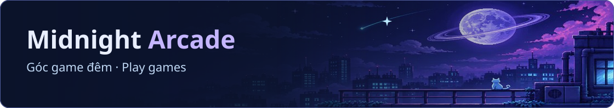

  

  <picture>
    <source media="(max-width: 600px)" srcset="./assets/beyond/intro-mobile.svg" />
    
  </picture>

  <picture>
    <source media="(max-width: 600px)" srcset="./assets/beyond/about-and-tech-mobile.svg" />
    
  </picture>

  <picture>
    <source media="(max-width: 600px)" srcset="./assets/beyond/projects-and-focus-mobile.svg" />
    
  </picture>

  <a href="https://github.com/pbl4-hotrodemthuoc/PILL-COUNTER-PROJECT"><strong>Pill Counter ↗</strong></a>
  &nbsp;·&nbsp;
  <a href="https://github.com/BichUyen2609/project_python/tree/journeys/apps/fundraising"><strong>Trái tim cho em · A Heart for You ↗</strong></a>
  &nbsp;·&nbsp;
  <a href="https://github.com/gameAI-group/KOMBAT_AI_PROJECT"><strong>Kombat AI ↗</strong></a>

  <a href="https://github.com/users/BichUyen2609/contributions">
    <picture>
      <source media="(max-width: 600px)" srcset="https://raw.githubusercontent.com/BichUyen2609/BichUyen2609/output/profile-activity-mobile.svg?v=2" />
      
    </picture>
  </a>

  <a href="https://github.com/users/BichUyen2609/contributions">
    <picture>
      <source media="(max-width: 600px)" srcset="https://raw.githubusercontent.com/BichUyen2609/BichUyen2609/output/weekly-activity-mobile.svg" />
      
    </picture>
  </a>

  <picture>
    <source media="(prefers-color-scheme: dark)" srcset="https://raw.githubusercontent.com/BichUyen2609/BichUyen2609/output/github-contribution-grid-snake-dark.svg" />
    
  </picture>

  <a href="https://bichuyen2609.github.io/BichUyen2609/">
    <picture>
      <source media="(max-width: 600px)" srcset="./assets/beyond/arcade-mobile.svg" />
      
    </picture>
  </a>

  <a href="https://bichuyen2609.github.io/BichUyen2609/?game=stars"><strong>Hứng sao · Star Catch</strong></a>
  &nbsp;·&nbsp;
  <a href="https://bichuyen2609.github.io/BichUyen2609/?game=memory"><strong>Lật thẻ mặt trăng · Moon Match</strong></a>
  &nbsp;·&nbsp;
  <a href="https://bichuyen2609.github.io/BichUyen2609/?game=rooftop"><strong>Nhảy mái nhà · Rooftop Hop</strong></a>

  <strong>Kết nối với mình · Connect with me</strong>
  &nbsp;
  
  
  

  <picture>
    <source media="(max-width: 600px)" srcset="./assets/beyond/footer-mobile.svg" />
    
  </picture>

<!-- Tech icons from Simple Icons (https://simpleicons.org/) and Devicon (https://github.com/devicons/devicon). -->
